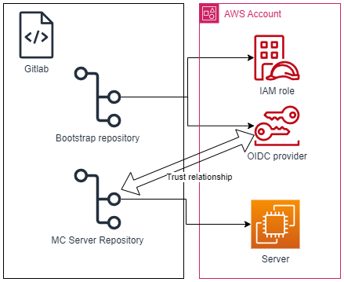

# Minecraft Server on AWS using CI/CD, fully automated

## Objective 

What we want to achieve is a fully automated deployment of a Minecraft Server using Terraform and CI/CD automation on Gitlab on AWS.  



### Pre-Requisites

#### Personal Access Token
If we are using the free version of Gitlab we will need a Personal Access Token (it would be better to use a project TOKEN but it is not posible to create inside a Group).  
This PAT will be used in the Manual deployment of the Bootstrap to access the [TFstate on Gitlab](https://docs.gitlab.com/ee/user/infrastructure/iac/terraform_state.html)  
Follow the instructions as specified [here](https://docs.gitlab.com/ee/user/profile/personal_access_tokens.html) and save it for later
#### AWS Account access
We also need the access key and secret access key for our AWS account, since we are going to deploy the bootstrap manually

### Bootstrap

The first step is to bootstrap the requirements for the deployment to be automated.  
For that we need first to create a trust relationship betweem the AWS Account and the Gitlab repository.
You can check the code here:  
https://gitlab.com/zeneke-tech/aws-minecraft-server/bootstrap

1. Create an .env file and put the following contents:
    - Your gitlab user
    - The PAT you created on the pre-requisites
    - The access key and secret access key that you created on the pre-requisites
```
export USER="yourgitlabusename@gmail.com"
export PASSWORD="glpat-GITLABPATTOKEN"
export AWS_ACCESS_KEY_ID="AWSACCESSKEY"
export AWS_SECRET_ACCESS_KEY="AWSSECRETACCESSKEY" 
```
2. Put the correct values on the configuration files for Terraform on the config/ folder
    - Here the most imporant settings are:
        - "address" that points where the TFstate will be saved.
        - "mcserver_repository" that will create the trust relationship for the deployments
3. Execute the following commands:  
`source .env`  
`terraform init --backend-config="config/backend-production.conf" -backend-config="username=$USER" -backend-config="password=$PASSWORD"`  
4. Execute the changes on terraform:  
`terraform plan --var-file="config/variables-production.tfvars" -out=$PLAN`  
`terraform apply plan-cache`  

### Minecraft Server deployment

Here everything is fully automated, you have to configure only:

1. The backend-production.conf file with the correct settings that points to the repository.
2. The variables-production.conf with your region and TAGs.
3. You have to create 3 variables on the repository:
    1. ROLE_ARN: with the ARN of the role previoulsy created on bootstrap
        - key: ROLE_ARN
        - value: arn:aws:iam::1234567890:role/gitlab-role
    2. PAT_USERNAME: the username that was used on the .env file on bootstrap (your gitlab username)
        - key: PAT_USERNAME
        - value: gitlabusername
    3. PAT_PASSWORD: the PAT token created on bootstrap
        - key: PAT_PASSWORD
        - value: pattoken
    4. SSH public key: To access the MC server through SSH
        - key: TF_VAR_ec2_key_pair
        - value: public_key_pair
4. Now when you push the changes to your repository, the CI/CD should automatically deploy the EC2, and install the Minecraft Server, and execute it inside a Tmux session.
5. You should be able to connect to the IP that the Job 'apply' gives you on gitlab to the standard port

### Improvements

There are a lot of improvements that can be done, I will divide it in the repositories

### Bootstap

1. Convert the manual deployment on a CI/CD pipeline
    - PROs: You dont have to execute anything manually
    - CONs: You have to put AWS credentials on the gitlab variables that can create IAM roles

#### Mc-server

1. Restrict the IP access for the SSH (now its open to everybody).
2. Create a variable for the port of the Minecraft server (now runs with the standard 25565)
